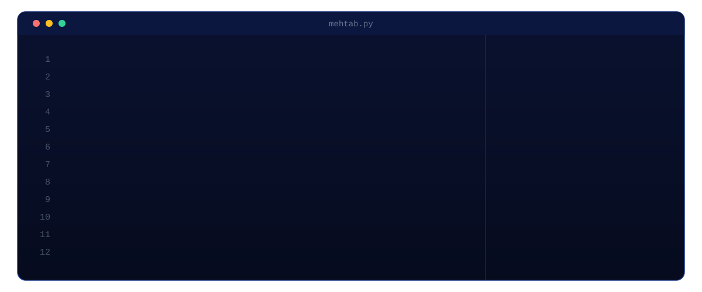
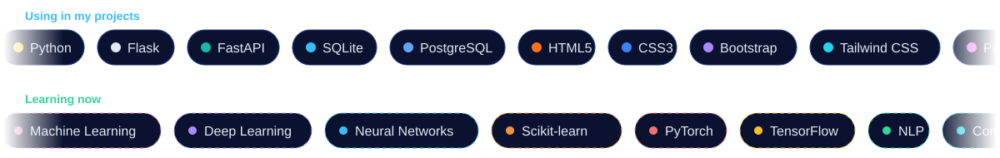

  

  
  
  
  

<h2 align="center">About me</h2>

  

I'm a Python backend developer and Computer Science undergraduate from Lahore, currently an **AI/ML intern at AbramSoft**. I build backend apps with Flask and FastAPI, analyse data with Pandas, and I'm now learning machine learning and deep learning.

**Open to:** entry-level Python backend and AI/ML roles, internships and remote work.

<h2 align="center">Tech stack</h2>

  

<h2 align="center">My journey</h2>

  

  
  

<h2 align="center">Projects</h2>

  
  
  

<h2 align="center">Say hi</h2>

  The quickest way to reach me is <a href="mailto:mahtabhussainofficial@gmail.com">email</a> or <a href="https://linkedin.com/in/mehtab--hussain">LinkedIn</a>.

  

